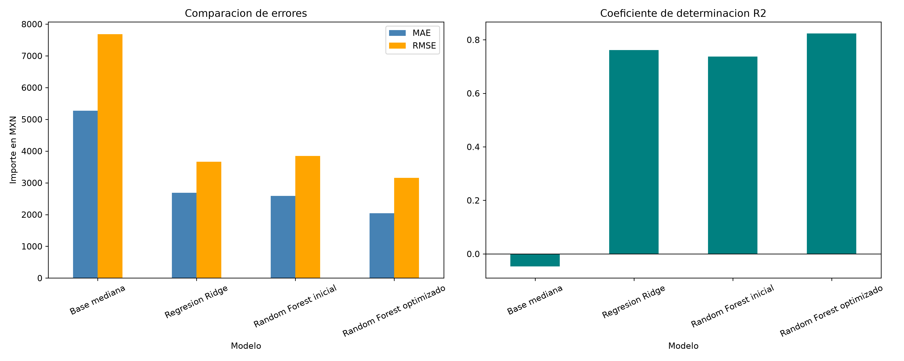
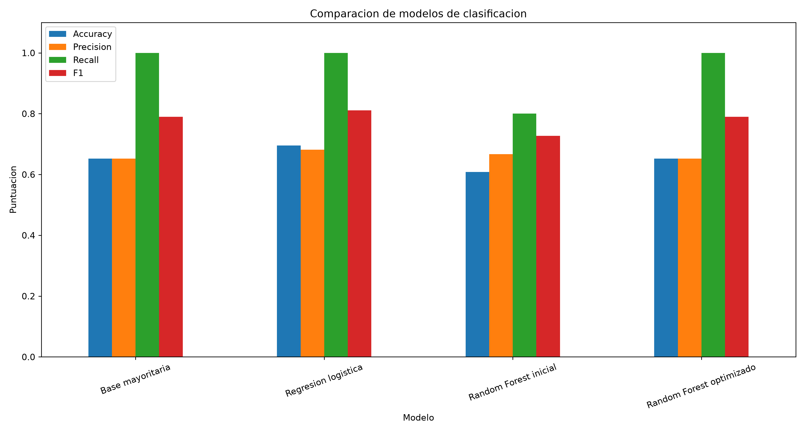
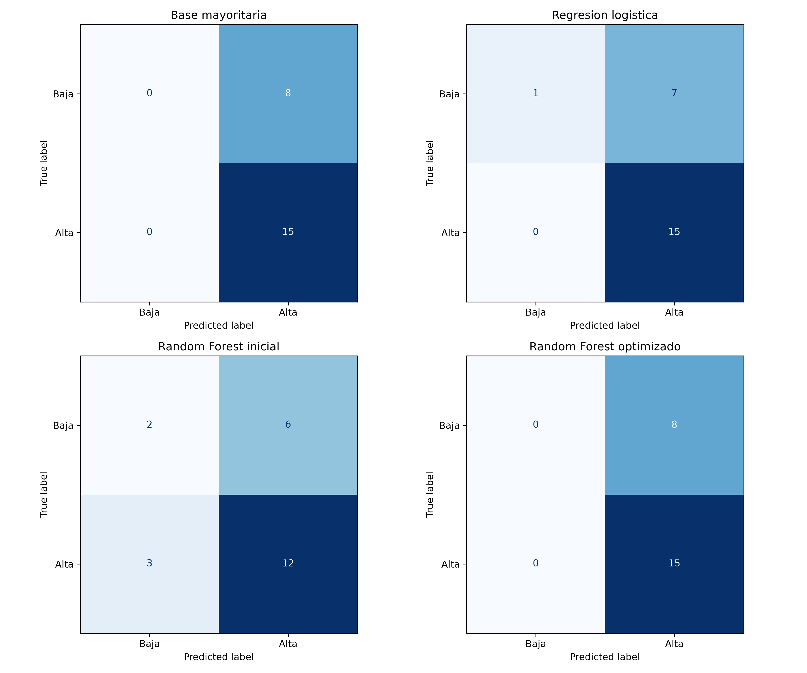

# Unidad 3 - Análisis supervisado de ventas

## Descripción del proyecto

Este proyecto continúa el caso de estudio de la Unidad 2, relacionado con el análisis de ventas de productos electrónicos.

Se implementan técnicas de aprendizaje supervisado para estimar el importe de las ventas y clasificar la demanda de los productos.

## Integrantes

- Juan Gerardo Galindo Pineda.
- Raúl de Jesús Martínez Cortez.
- Lidia Alejandra Guevara Ramírez.

## Objetivos

- Predecir el importe total de una venta.
- Clasificar la demanda como alta o baja.
- Comparar algoritmos de aprendizaje supervisado.
- Optimizar hiperparámetros mediante validación cruzada.
- Evaluar los modelos utilizando métricas de desempeño.

## Conjunto de datos

- Registros originales: 122.
- Registros limpios: 115.
- Registros descartados: 7.
- Datos de entrenamiento: 92.
- Datos de prueba: 23.
- Demanda alta: 77 registros.
- Demanda baja: 38 registros.

## Tecnologías utilizadas

- Python 3.11.9.
- Pandas.
- NumPy.
- Scikit-learn.
- Matplotlib.
- Seaborn.
- Joblib.
- Git y GitHub.
- Visual Studio Code.

## Estructura del proyecto

    unidad3/
    ├── modelos/
    ├── resultados/
    ├── scripts/
    │   ├── preparar_datos.py
    │   ├── modelo_regresion.py
    │   ├── modelo_random_forest.py
    │   ├── modelo_clasificacion.py
    │   └── comparar_modelos.py
    ├── requirements.txt
    └── README.md

## Instalación

    python -m venv .venv
    .\.venv\Scripts\python.exe -m pip install -r unidad3/requirements.txt

## Ejecución

Ejecutar desde la raíz del repositorio:

    .\.venv\Scripts\python.exe scripts/limpieza_datos.py
    .\.venv\Scripts\python.exe unidad3/scripts/preparar_datos.py
    .\.venv\Scripts\python.exe unidad3/scripts/modelo_regresion.py
    .\.venv\Scripts\python.exe unidad3/scripts/modelo_random_forest.py
    .\.venv\Scripts\python.exe unidad3/scripts/modelo_clasificacion.py
    .\.venv\Scripts\python.exe unidad3/scripts/comparar_modelos.py

## Resultados de regresión

| Modelo | MAE | RMSE | R2 |
|---|---:|---:|---:|
| Base mediana | 5269.57 | 7685.70 | -0.0469 |
| Regresión Ridge | 2688.27 | 3665.88 | 0.7618 |
| Random Forest inicial | 2588.43 | 3847.72 | 0.7376 |
| Random Forest optimizado | 2041.70 | 3156.32 | 0.8234 |

## Resultados de clasificación

| Modelo | Accuracy | Precision | Recall | F1 |
|---|---:|---:|---:|---:|
| Base mayoritaria | 0.6522 | 0.6522 | 1.0000 | 0.7895 |
| Regresión logística | 0.6957 | 0.6818 | 1.0000 | 0.8108 |
| Random Forest inicial | 0.6087 | 0.6667 | 0.8000 | 0.7273 |
| Random Forest optimizado | 0.6522 | 0.6522 | 1.0000 | 0.7895 |

## Gráficas comparativas

### Regresión

### Clasificación

### Matrices de confusión

## Conclusión

Random Forest optimizado presentó el mejor desempeño observado en regresión, mientras que la regresión logística obtuvo los mejores resultados de clasificación.

Debido al tamaño reducido del conjunto de datos y al desbalance de clases, los resultados deben interpretarse como una demostración académica y no como un sistema predictivo listo para producción.