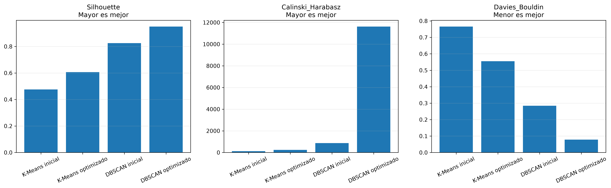
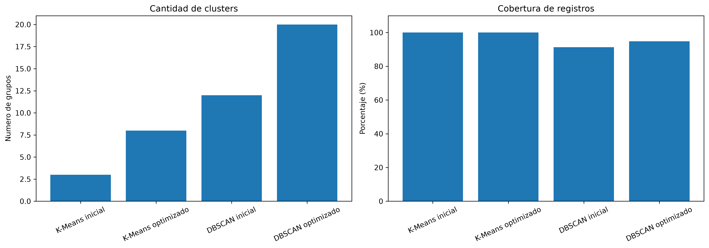
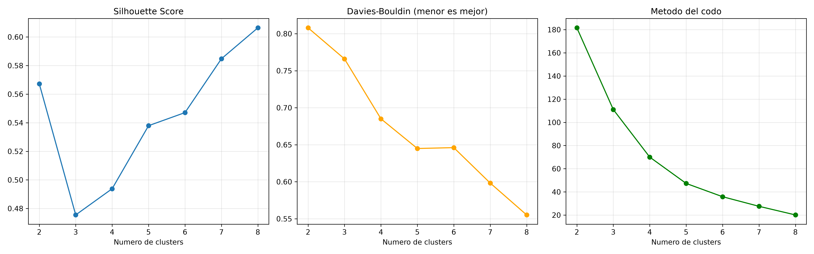
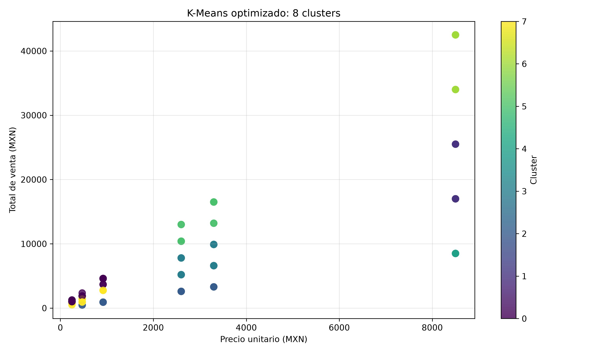
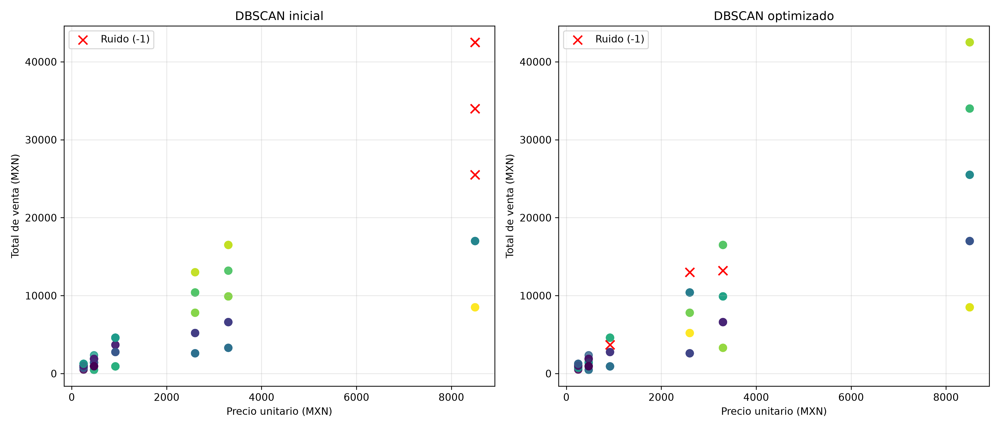
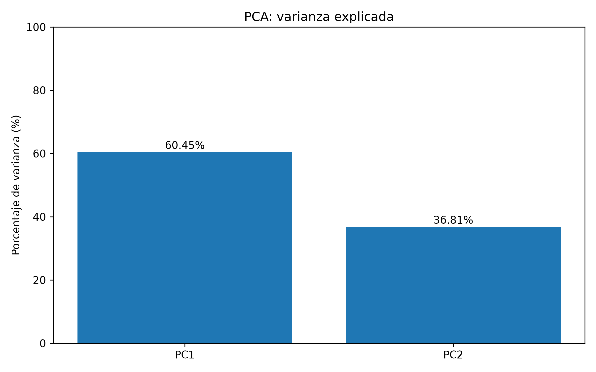
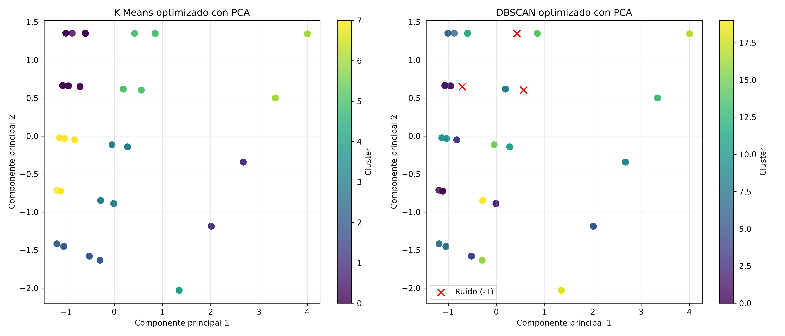

# Interpretación de resultados — Unidad 4: Análisis no supervisado de ventas

## 1. Contexto del análisis

En la Unidad 4 se aplicaron técnicas de aprendizaje no supervisado sobre los **115 registros limpios** del conjunto de datos `datos/ventas_limpias.csv` (generado en la Unidad 2), utilizando tres variables numéricas estandarizadas mediante `StandardScaler`:

- `cantidad` (unidades por venta, valores discretos de 1 a 5).
- `precio_unitario` (6 productos con precios fijos en MXN: Mouse 250 MXN, Teclado 470 MXN, Audífonos 920 MXN, Impresora 2,600 MXN, Monitor 3,300 MXN y Laptop 8,500 MXN).
- `total_venta` (importe total calculado como `cantidad × precio_unitario`).

Se entrenaron y optimizaron dos algoritmos de clustering con enfoques distintos (**K-Means** y **DBSCAN**), y posteriormente se aplicó **Análisis de Componentes Principales (PCA)** para reducir la dimensionalidad a dos ejes y facilitar la visualización e interpretación de los grupos obtenidos.

---

## 2. Resumen comparativo de los modelos evaluados

Los resultados consolidados en `unidad4/resultados/comparacion_final_modelos.csv` son los siguientes:

| Modelo | Parámetros principales | Clusters | Ruido | Cobertura | Silhouette (↑) | Calinski-Harabasz (↑) | Davies-Bouldin (↓) |
|--------|------------------------|---------:|------:|----------:|---------------:|----------------------:|-------------------:|
| K-Means inicial | `k = 3`, `n_init = 10` | 3 | 0 | 100.00% | 0.4755 | 117.9474 | 0.7659 |
| K-Means optimizado | `k = 8`, `n_init = 20` | 8 | 0 | 100.00% | 0.6064 | 246.7357 | 0.5552 |
| DBSCAN inicial | `eps = 0.5`, `min_samples = 5` | 12 | 10 | 91.30% | 0.8256 | 872.0835 | 0.2844 |
| DBSCAN optimizado | `eps = 0.2`, `min_samples = 3` | 20 | 6 | 94.78% | 0.9504 | 11626.8557 | 0.0782 |

> *Nota:* `(↑)` indica que un valor mayor refleja mejor desempeño; `(↓)` indica que un valor menor refleja mejor desempeño.

---

## 3. Diferencias entre K-Means y DBSCAN

Aunque ambos algoritmos buscan descubrir estructuras ocultas en los registros de ventas sin etiquetas previas, operan bajo principios matemáticos distintos que producen agrupamientos con propiedades y usos diferentes.

### 3.1 Cuadro comparativo general

| Criterio | K-Means | DBSCAN | Impacto observado en este proyecto |
|----------|---------|--------|------------------------------------|
| **Principio de agrupamiento** | Basado en **centroides** (minimiza la inercia o distancia euclidiana al centro de cada grupo). | Basado en **densidad** (agrupa puntos cercanos dentro de un radio `eps` con al menos `min_samples` vecinos). | K-Means particiona el espacio completo en regiones amplias; DBSCAN detecta concentraciones puntuales muy densas. |
| **Número de clusters** | Debe definirse previamente (`k`). Se evaluó `k` de 2 a 8 y se seleccionó `k = 8`. | Se determina **automáticamente** a partir de la densidad (`12` en la configuración inicial y `20` en la optimizada). | DBSCAN se adapta a la estructura discreta de los datos sin imponer una cantidad fija de grupos. |
| **Cobertura de registros** | **100%** (115 de 115 registros). Todos los datos reciben un cluster. | **Parcial** (`91.30%` inicial y `94.78%` optimizado). | K-Means garantiza clasificación total; DBSCAN deja fuera registros de baja densidad. |
| **Detección de ruido / atípicos** | No detecta ruido (`0` registros excluidos); los extremos afectan la posición de los centroides. | Etiqueta registros aislados o poco frecuentes como ruido (`cluster = -1`). | DBSCAN identificó combinaciones de venta infrecuentes (`10` en inicial y `6` en optimizado). |
| **Forma de los grupos** | Tiende a generar particiones convexas y de tamaño relativamente balanceado alrededor de centroides. | Puede identificar formas arbitrarias y grupos de tamaños desiguales siempre que sean densos. | En este dataset, DBSCAN separó casi cada combinación frecuente `(producto, cantidad)` en su propio micro-grupo. |
| **Sensibilidad a hiperparámetros** | Sensible a la elección de `k` y a la inicialización (mitigada con `n_init=20` y `random_state=42`). | Muy sensible a `eps` y `min_samples`: pequeños cambios modifican drásticamente el número de clusters y el ruido. | Al pasar de `(0.5, 5)` a `(0.2, 3)`, los clusters subieron de 12 a 20 y el ruido bajó de 10 a 6. |
| **Interpretabilidad comercial** | Alta en `k = 8`: segmentos amplios y manejables por gama de precio y volumen. | Baja en `20` clusters si se busca segmentación general; alta para auditar patrones exactos y anomalías. | K-Means es más práctico para estrategias comerciales globales; DBSCAN destaca para control de densidad y casos raros. |

### 3.2 Comportamiento observado en K-Means

- **K-Means inicial (`k = 3`):** Separó las ventas en tres bloques generales:
  - *Cluster 0 (15 registros):* ventas de **Laptop** con volumen medio-alto (cantidad promedio `3.40`, total promedio `28,900 MXN`).
  - *Cluster 1 (33 registros):* compras de **bajo volumen** (cantidad promedio `1.42`, total promedio `3,830.30 MXN`).
  - *Cluster 2 (67 registros):* compras de **alto volumen** en accesorios y gama media (cantidad promedio `4.00`, total promedio `5,230.15 MXN`).
  Aunque simple, su cohesión fue moderada (`Silhouette = 0.4755`, `Inercia = 111.07`).

- **K-Means optimizado (`k = 8`):** Al evaluar `k` de 2 a 8, el modelo con `k = 8` maximizó el índice Silhouette (`0.6064`), incrementó Calinski-Harabasz a `246.7357`, redujo Davies-Bouldin a `0.5552` y bajó la inercia a `20.13`. Esto produjo segmentos bien diferenciados por **gama de producto y cantidad**:
  - **Gama alta (Laptop, 8,500 MXN):** dividida en 3 niveles de volumen — compra unitaria (*Cluster 4*, 5 ventas), volumen medio de 2–3 unidades (*Cluster 1*, 8 ventas) y volumen alto de 4–5 unidades (*Cluster 6*, 7 ventas).
  - **Gama media (Impresora y Monitor, 2,600–3,300 MXN):** separada en volumen medio de 2–3 unidades (*Cluster 3*, 17 ventas) y volumen alto de 4–5 unidades (*Cluster 5*, 14 ventas).
  - **Accesorios (Mouse, Teclado y Audífonos, 250–920 MXN):** divididos en volumen medio (*Cluster 7*, 18 ventas) y volumen alto (*Cluster 0*, 32 ventas).
  - **Compras unitarias generales (cantidad = 1, sin Laptop):** agrupadas en *Cluster 2* (14 ventas).

### 3.3 Comportamiento observado en DBSCAN

- **DBSCAN inicial (`eps = 0.5`, `min_samples = 5`):** Identificó **12 clusters** y **10 registros de ruido** (cobertura de `91.30%`). Los 10 puntos marcados como ruido correspondieron a ventas de **Laptop con cantidades de 3, 4 y 5 unidades**, ya que cada una de esas combinaciones apareció menos de 5 veces en el historial (3, 3 y 4 registros, respectivamente).

- **DBSCAN optimizado (`eps = 0.2`, `min_samples = 3`):** Reducir `min_samples` a `3` permitió recuperar las ventas de Laptop de alto volumen como clusters válidos (aumentando la cobertura a `94.78%`), mientras que reducir `eps` a `0.2` generó **20 micro-clusters** extremadamente compactos y solo **6 registros de ruido** (`cluster_dbscan = -1`):
  - `Audífonos` × 4 unidades (`id_venta`: 22 y 52 — 2 ocurrencias).
  - `Impresora` × 5 unidades (`id_venta`: 29 y 53 — 2 ocurrencias).
  - `Monitor` × 4 unidades (`id_venta`: 33 y 45 — 2 ocurrencias).

  Estos 6 registros fueron clasificados como ruido porque su frecuencia exacta es inferior al umbral de densidad (`min_samples = 3`) y se encuentran a una distancia mayor a `eps = 0.2` respecto de otras combinaciones de producto y cantidad.

### 3.4 Interpretación crítica de las métricas entre ambos modelos

A primera vista, **DBSCAN optimizado** supera ampliamente a **K-Means optimizado** en las tres métricas internas (`Silhouette: 0.9504 vs. 0.6064`, `Calinski-Harabasz: 11626.86 vs. 246.74`, `Davies-Bouldin: 0.0782 vs. 0.5552`). Sin embargo, estas cifras **no son directamente equivalentes** por dos razones metodológicas clave:

1. **Exclusión del ruido en el cálculo:** En `unidad4/scripts/modelo_dbscan.py`, las métricas de DBSCAN se calculan únicamente sobre los registros válidos (`etiquetas != -1`, es decir, 109 registros en el modelo optimizado), mientras que en K-Means se evalúan los 115 registros completos (100% de cobertura). Excluir los puntos más difíciles o dispersos favorece directamente la separación medida.
2. **Efecto de la granularidad sobre datos discretos:** Debido a que las ventas provienen de 6 precios unitarios fijos y cantidades enteras de 1 a 5, existen múltiples registros con coordenadas idénticas en el espacio estandarizado. Al formar 20 micro-clusters con `eps = 0.2`, la mayoría de los grupos de DBSCAN contienen registros casi o totalmente idénticos (distancia intra-cluster cercana a cero), lo que dispara el índice Calinski-Harabasz, aproxima Silhouette a `1.0` y lleva Davies-Bouldin cerca de `0.0`.

**Síntesis comparativa:** DBSCAN optimizado ofrece la mayor pureza geométrica y capacidad de detección de patrones infrecuentes, pero fragmenta el catálogo en demasiados micro-grupos (`20`) para una segmentación gerencial sencilla. K-Means optimizado (`k = 8`), aunque con métricas menores al cubrir el 100% de los datos y agrupar rangos más amplios, resulta más equilibrado y fácil de traducir en segmentos comerciales accionables. Ambos modelos son, por tanto, **complementarios**.

---

## 4. Análisis y conclusiones sobre PCA

El Análisis de Componentes Principales (PCA) se aplicó sobre las tres variables estandarizadas (`unidad4/scripts/modelo_pca.py`) para proyectar los datos en dos dimensiones (`PC1` y `PC2`) y comparar visualmente los agrupamientos de K-Means y DBSCAN.

### 4.1 Varianza explicada

| Componente | Varianza explicada | Varianza acumulada |
|------------|-------------------:|-------------------:|
| **PC1** | 60.45% | 60.45% |
| **PC2** | 36.81% | 97.26% |
| *Descartado (PC3)* | *2.74%* | *100.00%* |

Con únicamente **dos componentes principales** se conserva el **97.26%** de la variabilidad total de los datos originales, perdiendo apenas un **2.74%** de información. Esto confirma que la reducción de 3 a 2 dimensiones es altamente fiel y prácticamente libre de distorsión estructural.

### 4.2 Interpretación de los pesos (cargas) de los componentes

De acuerdo con `unidad4/resultados/componentes_pca.csv`, la contribución de cada variable estandarizada a los dos componentes principales es:

| Componente | `cantidad_escalado` | `precio_unitario_escalado` | `total_venta_escalado` | Interpretación del eje |
|------------|--------------------:|---------------------------:|-----------------------:|------------------------|
| **PC1 (60.45%)** | `0.0624` | `0.6972` | `0.7142` | **Dimensión de valor económico / gama de producto:** combina casi por igual el precio unitario y el monto total de venta, con influencia mínima de la cantidad. |
| **PC2 (36.81%)** | `0.9441` | `-0.2733` | `0.1843` | **Dimensión de volumen de compra:** dominada ampliamente por la cantidad de unidades adquiridas (`0.9441`), separando compras pequeñas de pedidos de mayor volumen. |

La razón matemática por la que solo dos ejes explican el **97.26%** de la varianza es la fuerte redundancia estructural existente entre las tres variables: `total_venta` surge directamente del producto `cantidad × precio_unitario`. Por ello, la información relevante del conjunto de datos se concentra esencialmente en dos factores independientes: **qué tan costoso es el producto/venta (PC1)** y **cuántas unidades se compraron (PC2)**.

### 4.3 Validación visual de los agrupamientos con PCA

La proyección bidimensional (`unidad4/resultados/comparacion_pca.png`) permite contrastar ambos modelos sobre un mismo plano ortogonal:

A partir de esta visualización se observan los siguientes hallazgos:

1. **Estructura discreta visible en el plano:** Los puntos forman columnas y niveles definidos en el espacio `(PC1, PC2)` debido a los precios fijos de los productos y las cantidades enteras (1 a 5). Las ventas de Laptop se ubican claramente hacia la derecha (`PC1 > 1.3`), ordenadas de abajo hacia arriba según la cantidad comprada (`PC2` desde `-2.0` hasta `+1.35`).
2. **Partición continua en K-Means:** En el panel izquierdo se aprecia que K-Means optimizado (`k = 8`) divide limpiamente el plano en regiones amplias y coherentes sin solapamientos evidentes, integrando todos los registros en segmentos comprensibles de valor y volumen.
3. **Micro-agrupación y ubicación del ruido en DBSCAN:** En el panel derecho se observa cómo DBSCAN optimizado asigna un color distinto a cada concentración puntual y marca con `×` roja las 3 coordenadas correspondientes a los 6 registros de ruido, ubicados en la parte superior izquierda y central (combinaciones poco frecuentes de cantidad 4 y 5 en productos de gama baja y media).

### 4.4 Conclusiones específicas sobre PCA

- **Alta eficiencia de compresión:** Reducir de 3 a 2 dimensiones reteniendo el **97.26%** de la varianza demuestra que las variables originales contienen redundancia lineal importante (especialmente entre `precio_unitario` y `total_venta`).
- **Ejes con significado de negocio claro:** `PC1` sintetiza el **valor económico** de la transacción y `PC2` representa el **volumen de unidades**, lo cual convierte a PCA no solo en una herramienta gráfica, sino en un resumen interpretable del comportamiento comercial.
- **Uso metodológico adecuado:** En este flujo de trabajo, PCA se utilizó exclusivamente para **visualización e interpretación** posterior al entrenamiento, manteniendo los modelos de clustering sobre las variables estandarizadas originales para no descartar el `2.74%` de varianza restante ni alterar las distancias empleadas por `eps` en DBSCAN.
- **Alcance y limitaciones:** PCA captura únicamente relaciones lineales y depende directamente de la estandarización previa (`StandardScaler`); sin estandarizar, `total_venta` (en miles de pesos) habría dominado casi por completo el primer componente ocultando el efecto de `cantidad`.

---

## 5. Conclusión general

El análisis no supervisado permitió comprender la estructura real del historial de ventas desde dos ángulos complementarios:

- **K-Means optimizado (`k = 8`)** es la opción más recomendable cuando el objetivo es obtener una **segmentación comercial completa (100% de cobertura)** y fácil de interpretar en términos de gama de producto y volumen de compra.
- **DBSCAN optimizado (`eps = 0.2`, `min_samples = 3`)** es la mejor alternativa cuando se busca **detectar patrones de alta densidad y aislar registros poco frecuentes o atípicos** (`6` registros de ruido), teniendo siempre presente que sus elevadas métricas internas se explican tanto por la exclusión del ruido como por la alta fragmentación (`20` micro-clusters) sobre datos discretos.
- **PCA** validó visualmente ambos enfoques al resumir el **97.26%** de la información en dos ejes intuitivos (**valor económico** y **volumen**), confirmando la coherencia de los grupos encontrados y la ubicación exacta de los valores atípicos.

Al igual que en la Unidad 3, debido al tamaño acotado del conjunto de datos (`115` registros) y a su catálogo reducido de precios fijos, estos resultados deben interpretarse como un ejercicio académico riguroso sobre los patrones históricos disponibles y como base metodológica escalable a conjuntos de ventas de mayor volumen y variabilidad.
